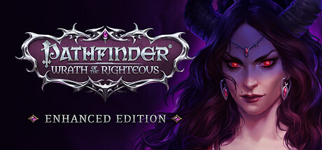

**Pathfinder: Wrath of the Righteous is a deep CRPG set in a crusade against demonic forces, featuring 10 mythic paths that fundamentally alter your character's abilities. One of the most complex and rewarding tabletop-adapted RPGs ever made for PC.**

---

## 📖 About

Pathfinder: Wrath of the Righteous is a deep CRPG set in a crusade against demonic forces, featuring 10 mythic paths that fundamentally alter your character's abilities. One of the most complex and rewarding tabletop-adapted RPGs ever made for PC.

## ⚠️ Problems Without Trainer

| Problem | Status |
|---------|--------|
| **System Complexity** — Pathfinder's rules are overwhelming without tabletop background | ✅ Solved |
| **Crusade Management** — Strategic layer is confusing and penalizes neglect | ✅ Solved |
| **Difficulty Extremes** — Core difficulty is brutal for players new to CRPGs | ✅ Solved |
| **Build Pitfalls** — Wrong skill point allocation can brick characters at late game | ✅ Solved |

## ✅ Solution

The **Pathfinder: Wrath of the Righteous Trainer** solves all these issues by giving you complete control over the game.

## 🎯 Full Feature List

- Unlimited Resources
- God Mode / Invincibility
- Instant Skill Cooldown
- One-Hit Kill
- Freeze Game Timer
- Unlock All Items & Achievements
- Custom Speed Multiplier
- Save State Anywhere

## 🚀 Quick Start

1. **Disable Windows Defender** temporarily (trainer may trigger false positive)
2. Download the trainer from the button above
3. Launch Pathfinder: Wrath of the Righteous
4. Run the trainer as Administrator
5. Activate desired cheats with hotkeys

## 💎 Free vs Paid

| Feature | Free | Pro |
|---------|------|-----|
| Basic God Mode | ✅ | ✅ |
| Unlimited Resources | ✅ | ✅ |
| All Advanced Cheats | ❌ | ✅ |
| Auto-Updates | ❌ | ✅ |
| Priority Support | ❌ | ✅ |

## 💻 Requirements

- Windows 10/11 (64-bit)
- Pathfinder: Wrath of the Righteous (any version)
- .NET Framework 4.8+
- DirectX 11+

## 🍎 macOS

macOS users can use our alternative tool:

## ⚖️ Legal

This trainer is for educational and single-player use only. Use responsibly.

---

